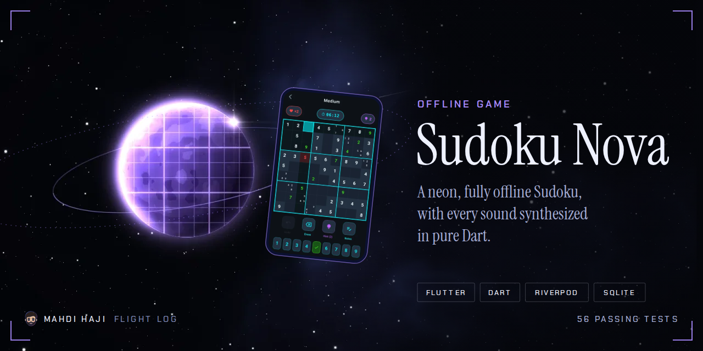
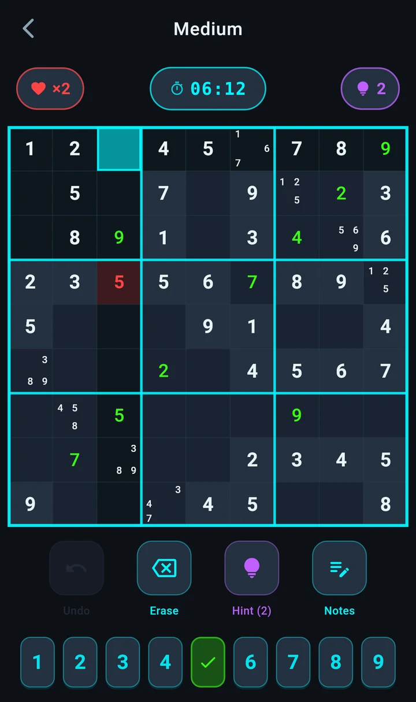

# Sudoku Nova

A neon, fully offline Sudoku game for Android, built from scratch in Flutter. Every sound effect is synthesized at runtime in pure Dart, and the hint system explains *why* a number is forced, in plain language.

`Flutter` `Dart` `Riverpod` `go_router` `SQLite` `Android`

<table>
<tr>
<td align="center" width="50%"><br><sub>Playing a medium puzzle</sub></td>
<td align="center" width="50%"><br><sub>The win screen</sub></td>
</tr>
</table>

## Features

- **Four difficulties**, from Easy (40–45 clues, 5 lives, 5 hints) to Impossible (22–26 clues, 1 life, 1 hint).
- **Every puzzle has exactly one solution.** Puzzles are generated by backtracking on a background isolate, and each removed cell is checked to keep the solution unique, so the UI never freezes.
- **Hints that explain themselves.** The explainer spots the "last number" in a unit and the "only spot left" in a box, row or column, and says so in plain words. Longer chains get a neutral fallback.
- **Ten synthesized sounds:** correct, wrong, win, lose, hint, undo, erase, select, tap and dismiss. Each is a sine-wave tone built in Dart at startup, with no audio files bundled, and each is paired with haptic feedback.
- **Notes mode and undo:** pencil marks in a 3×3 micro-grid inside each cell, and undo that restores a full grid snapshot.
- **History and best times:** every finished game goes into SQLite, and an unfinished game is saved on every move and restored when you come back.
- Dark and light themes.

## How it's built

```
lib/
  engine/    pure Dart, no Flutter imports: generator, solver, validator, hint explainer, difficulty rater
  data/      models, data sources and repositories (sqflite, shared_preferences)
  features/  one folder per screen: menu, difficulty, game, result, history, settings
  core/      theme, router (go_router), services, constants
  shared/    widgets used across screens
```

The engine has no Flutter dependency, so it is unit-tested on its own and runs on a background isolate.

## Run it

```bash
flutter pub get
flutter run              # Android device or emulator
flutter run -d linux     # Linux desktop, for development
flutter test             # 56 tests: engine, hint explainer, board and number pad widgets
flutter analyze
```

Release builds read the signing key from `android/key.properties`, which is git-ignored and never committed.

## Design decisions

- **The engine knows nothing about Flutter.** That keeps it testable on its own and lets it run on an isolate.
- **Sound is generated, not shipped.** The ten effects are built from sine waves at startup, so there are no audio assets to bundle.
- **A hint names the reason, not just the answer**, so it teaches the technique.

## Links

[Case study](https://mahdi-haji.dev/sudoku.html) · [Privacy policy](https://mahdi-haji.dev/sudoku-privacy.html) · [All projects](https://github.com/mahdawemghr)

Released under the [MIT License](LICENSE). © 2026 Mahdi Haji.
